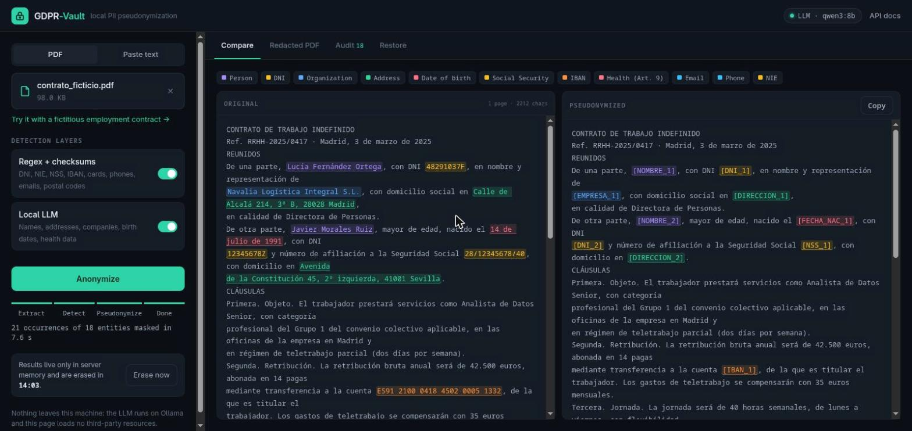
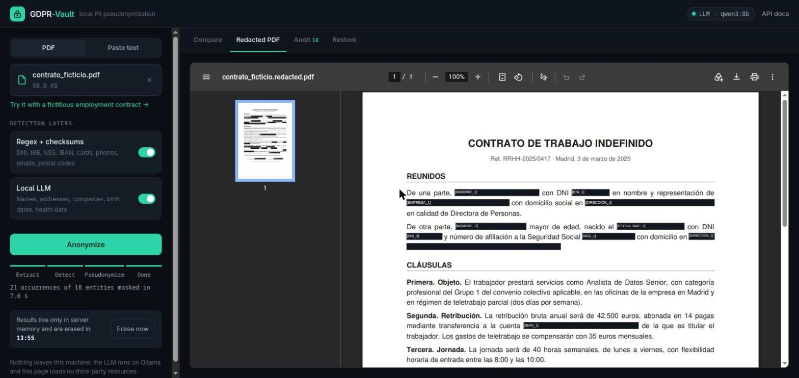
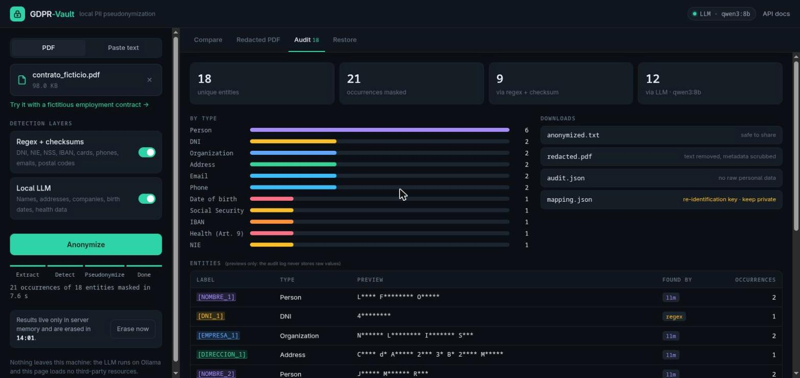
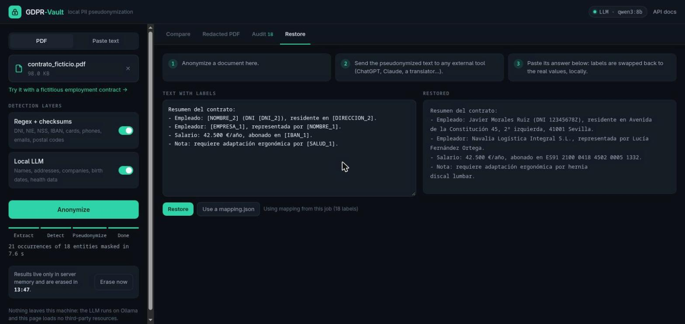
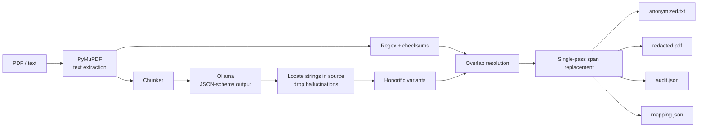

# GDPR-Vault

**Local PII detection and pseudonymization for Spanish business documents.**
Upload a contract, payslip or CV. GDPR-Vault finds the personal data with checksum-validated
patterns plus a local LLM, replaces each item with a stable label such as `[NOMBRE_1]` or `[DNI_1]`,
and returns a properly redacted PDF. Nothing is sent to an external service.


-black)
[](https://github.com/davidgj98/gdpr-vault/actions/workflows/ci.yml)




---

## Why

Teams want to use AI on documents full of personal data: summarising contracts,
translating HR files, extracting clauses. Sending those documents to an external API
means a transfer of personal data to a processor, often outside the EU. GDPR-Vault
handles the step before that:

```
contract.pdf ──► GDPR-Vault (on your machine) ──► text with [NOMBRE_1], [DNI_1]… ──► any external AI
                        │                                                              │
                   mapping.json (stays local) ◄──────── Restore: labels → real values ◄┘
```

The external tool never sees who the people are, but its answer can still be turned back
into a document with the real names, locally. That is **pseudonymization** as defined in
GDPR Art. 4(5). See [GDPR_NOTES.md](GDPR_NOTES.md) for how the design maps to the Regulation.

## Features

- **Hybrid detection**
  - **Regex with checksum validation** for structured identifiers: DNI and NIE (mod 23),
    IBAN (mod 97, length per country), Social Security number (mod 97), cards (Luhn),
    Spanish phones in any format, emails, and postal codes only when they appear in an address.
  - **Local LLM** (Ollama, constrained with a JSON schema) for semantic entities: people, addresses,
    companies, birth dates and health data (a special category under Art. 9).
  - **Resolution rules**: a validated regex hit beats the LLM when they overlap, an LLM address absorbs
    the postal code inside it, and entities the model invents are discarded because they are not in the text.
- **Consistent pseudonyms**: the same person gets the same label throughout the document. Once a full
  name is known, honorific variants such as *"el Sr. Morales"* are caught as well.
- **True PDF redaction**: the underlying text is removed, not just covered with a black box, and document metadata (author, title) is scrubbed.
- **Re-identification** (Restore tab, `POST /api/deanonymize`): paste the external AI's answer to get the real values back.
- **Audit log with no raw PII**: it records labels, types, counts, detection method and masked previews (`J***** M******`).
- **Privacy by design**: results are kept in memory and erased after a TTL (15 min by default) or on demand. The UI is held to a strict CSP with no third-party requests (not even web fonts), and API responses are sent with `Cache-Control: no-store`.
- **Fails loudly**: if Ollama is down, the job still masks the structured identifiers, but the UI and the audit log say plainly that names and addresses were **not** checked.

| Redacted PDF | Audit log | Restore |
|---|---|---|
|  |  |  |

## Quick start

### Docker (recommended)

```bash
git clone https://github.com/davidgj98/gdpr-vault && cd gdpr-vault
docker compose up --build          # add  -f docker-compose.yml -f docker-compose.gpu.yml  for NVIDIA GPUs
```

Open <http://localhost:8000> and click **"Try it with a fictitious employment contract"**.

The first start downloads the model (`qwen2.5:7b`, about 4.7 GB) into a volume. While that runs,
the header shows the LLM as unavailable and the app works in regex-only mode.

### Local development

```bash
python -m venv .venv && source .venv/bin/activate
pip install -r requirements-dev.txt
ollama pull qwen2.5:7b             # or any instruction-tuned model, see .env.example
uvicorn app.main:app --reload
pytest                             # 55 tests; the LLM is mocked, so Ollama is not needed
```

## How it works



A few design decisions:

| Decision | Reason |
|---|---|
| The LLM returns *strings*, not character offsets | LLMs are unreliable at counting characters. Offsets are found by searching the source text, which also rejects any entity that is not actually there. |
| Replacement in **one pass over spans** | Chained `str.replace` calls can match inside labels already inserted or inside other words (`Ana` in `mañana`). |
| Checksums on every identifier that has one | `42.500` or a reference like `2025/0417` is never masked, while a real DNI written as `48291037-f` still is. |
| Small LLM chunks (about 1,800 characters) with overlap | Smaller 3–8B models lose recall on long inputs. Overlap keeps entities that fall on a chunk boundary. |
| Ligatures expanded at extraction | PDF text such as `afiliación` (with an `fi` ligature) would not match what the model returns. |
| Redaction rectangles inset vertically | Redaction deletes every glyph the rectangle touches. Without the inset, it removed letters from the neighbouring line (this is covered by a regression test). |

## API

Interactive documentation is at `/docs`.

| Method | Endpoint | Description |
|---|---|---|
| `POST` | `/api/jobs` | Multipart: `file` (PDF) **or** `text`, plus `use_regex` and `use_llm`. Returns `202` with a `job_id`. |
| `GET` | `/api/jobs/{id}` | Status and progress; when done, the texts, replacement offsets, mapping and audit. |
| `GET` | `/api/jobs/{id}/files/{name}` | `anonymized.txt`, `redacted.pdf`, `audit.json` or `mapping.json` |
| `DELETE` | `/api/jobs/{id}` | Erase the job immediately |
| `POST` | `/api/deanonymize` | `{text, mapping}` → `{text, restored}` (stateless) |
| `GET` | `/api/health` | Whether Ollama is reachable and the model is pulled |

```bash
curl -F file=@frontend/samples/contrato_ficticio.pdf localhost:8000/api/jobs
# {"job_id":"3f2c…","status":"queued"}
curl localhost:8000/api/jobs/3f2c…/files/anonymized.txt
```

## Project structure

```
app/
  main.py            FastAPI app factory, security headers, TTL janitor
  config.py          settings from environment variables / .env
  pipeline.py        extract → detect → pseudonymize → redact, plus the audit
  anonymizer.py      overlap resolution, labelling, span replacement, restore
  pdf.py             extraction and true redaction (PyMuPDF)
  jobs.py            in-memory job store with expiry
  detectors/
    regex.py         patterns + DNI/NIE/IBAN/NSS/Luhn validators
    llm.py           Ollama client, chunking, hallucination filter, honorifics
  api/routes.py      REST endpoints
frontend/            static UI (vanilla JS, no build step, no external assets)
samples/             generator for the synthetic demo contract
tests/               regex, anonymizer and end-to-end API tests (LLM mocked)
```

## Measured performance

On the sample contract (one A4 page, 18 entities), RTX 3070 Laptop with 8 GB VRAM:

| Model | Time (warm) | Notes |
|---|---|---|
| `qwen2.5:3b` | about 7 s | Good recall; mislabels some IDs, but the regex priority rule fixes them |
| `qwen3:8b` | about 8 s | Best results in testing; also catches the date of birth and the health data |
| regex only | < 50 ms | Structured identifiers only |

## Limitations

- Native PDFs only (scanned documents need OCR, which is not implemented).
- LLM recall is high but not 100%. Treat the output as a strong first pass for a human to review.
- Indirect identifiers (a rare job title plus a small town) are not detected.
- Tuned for Spanish documents (identifiers, phone formats, honorifics).
- The job store is in memory and single-process. Scaling out would need Redis with TTLs.

## License

MIT. The demo contract is synthetic; its identifiers are the standard example values used in Spanish documentation.
